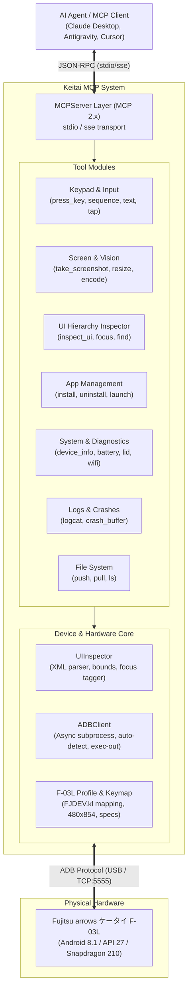

# Architecture & Design of Keitai MCP

This document outlines the architecture, component interactions, and technical design decisions of **Keitai MCP**.

---

## 1. High-Level Architecture



---

## 2. Layer Descriptions

### 2.1 Server Layer (`keitai_mcp.server`)
- Built on the official Python `mcp` SDK (`mcp.server.mcpserver.MCPServer`).
- Exposes **28 specialized tools**, **3 technical resources**, and **2 agent prompts**.
- Configures comprehensive system instructions so connected LLM agents are immediately primed with the constraints of Japanese Keitai (non-touch 480×854, physical D-Pad, softkeys).

### 2.2 Tool Layer (`keitai_mcp.tools.*`)
- **Keypad & Navigation (`keypad.py`)**: Resolves friendly key names into Android KeyEvent integers, formats shell injection commands, and handles long-presses and multi-key navigation sequences.
- **Screen & Vision (`screen.py`)**: Executes binary screen capture, converts to PIL Image, applies optional downscaling, saves PNG files, and returns base64 `types.ImageContent` and metadata `types.TextContent`.
- **UI Hierarchy (`ui.py`)**: Coordinates with `UIInspector` to capture view hierarchies and formats token-efficient summaries.
- **App Management (`apps.py`)**: Sideloads APKs with `-r -g` flags, launches activities, and handles package lifecycle.
- **System & Diagnostics (`system.py`)**: Aggregates specs, battery service telemetry, lid sensor switches, and network configuration.
- **Logs & Crashes (`logs.py`)**: Filters logcat by package PID or tag, inspects `/dev/log/crash`, and extracts fatal exception traces.
- **File Transfer (`files.py`)**: Encapsulates `adb push`, `pull`, and structured directory listings.

### 2.3 Device & Hardware Core (`keitai_mcp.device.*`)
- **`ADBClient` (`adb.py`)**:
  - Full asynchronous execution using `asyncio.create_subprocess_exec`.
  - Automatic device discovery: prioritizes the connected Fujitsu F-03L (`product:F03L`, `model:F_03L`).
  - Binary safety: uses `adb exec-out` rather than `adb shell screencap` to prevent host terminal newline conversion (`\r\n` vs `\n`) from corrupting binary PNG image data.
  - Timeout protection: prevents long-running commands from hanging agent loops.
- **`UIInspector` (`inspector.py`)**:
  - Parses Android `uiautomator dump` XML trees.
  - Computes bounding rectangles `[x1, y1][x2, y2]` and center point coordinates `(cx, cy)`.
  - Identifies which element holds `focused="true"` and which elements are `clickable="true"` or `focusable="true"`.
  - Generates token-friendly indented text representations to prevent overflowing LLM context windows.
- **`F-03L Profile` (`f03l.py`)**:
  - Hardened mappings extracted directly from the phone's physical layout file (`/system/usr/keylayout/FJDEV.kl`).
  - Screen dimensions (480 × 854), sub-display specifications (96 × 32 OLED), CPU architecture (`armeabi-v7a`), and clamshell lid states.

---

## 3. Key Design Decisions

### 3.1 Token Optimization for LLMs
Raw Android `uiautomator dump` XML for a single screen often exceeds 30,000 characters (thousands of tokens) filled with redundant container nodes. Keitai MCP's `UIInspector` strips empty structural wrappers and formats each interactive element into a single line:
```
- Button [★FOCUSED, CLICKABLE, FOCUSABLE] text="Wi-Fi" id="wifi_item" bounds=[10, 90][470, 160] center=[240, 125]
```
This reduces token usage by ~85% while giving the agent all critical information: the element's label, its ID, whether it currently has cursor focus, and where it is located.

### 3.2 Dual MCP Return Types (Vision + Metadata)
When an agent calls `keitai_take_screenshot`:
1. It returns an `ImageContent` block with base64 PNG data, enabling multimodal vision models to "see" the exact rendering.
2. It returns a `TextContent` block containing JSON metadata (current package, current activity, image dimensions, file path).

### 3.3 Clamshell Flip Lid Detection
Fujitsu F-03L features a hardware flip sensor routed via `gpio_lid`. Keitai MCP queries `dumpsys window policy` for `mLidState`:
- `mLidState=1` -> Clamshell is **OPEN**.
- `mLidState=0` -> Clamshell is **CLOSED** (sub-display active, main screen off).
- `mLidState=-1` -> Unknown / not supported.

This enables agents to know if an action failed simply because the physical phone was shut.

